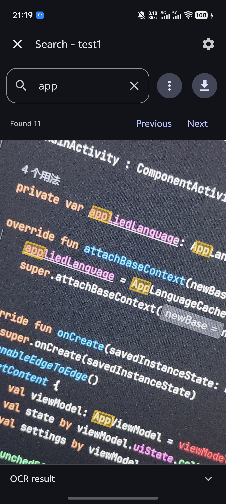
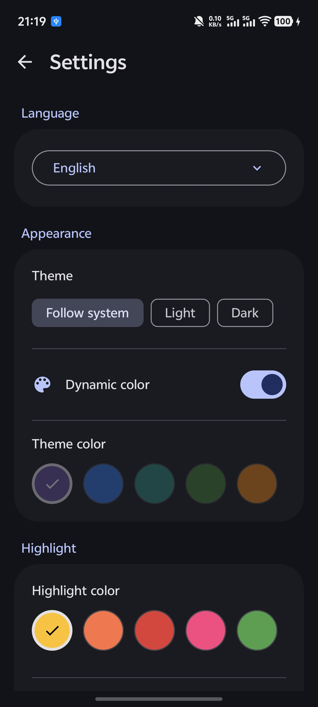
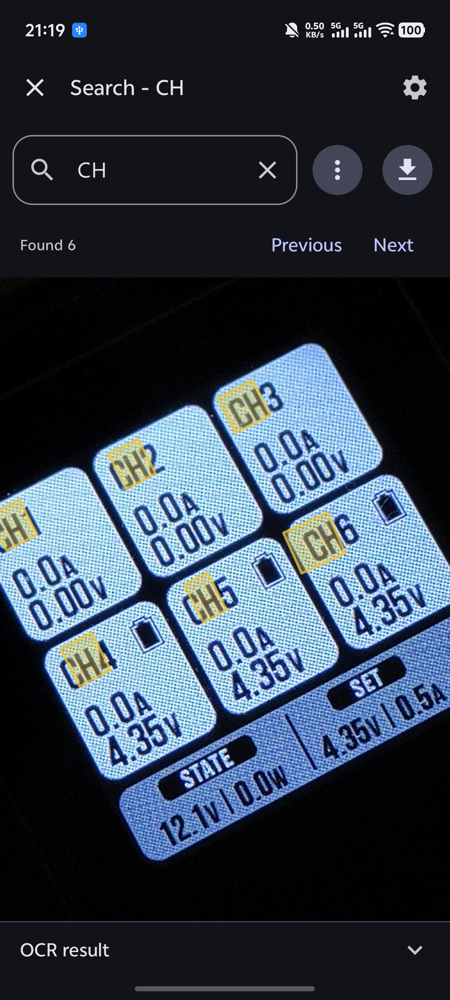
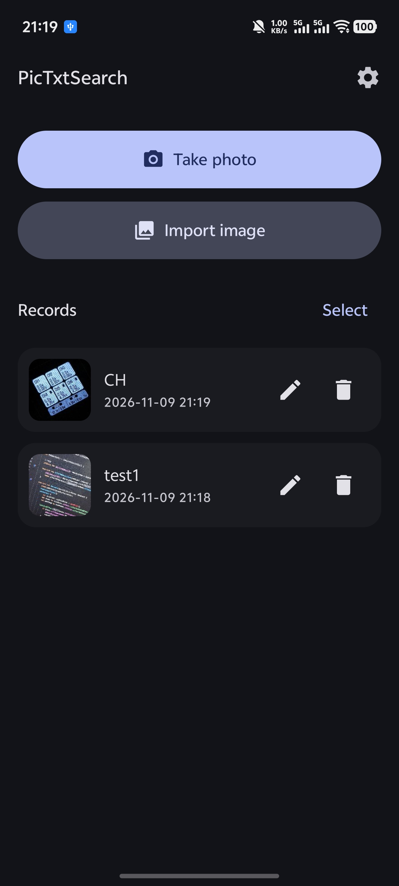

# PicTxtSearch

[简体中文](README.zh.md) · [English](README.md)

PicTxtSearch is an Android app for searching text in images: it recognizes the text in a picture and lets you locate and highlight keywords on the image, just like searching a web page.

## Features

- **Text recognition (OCR)**: extracts text from images, including Chinese
- **Keyword search**: regular expressions, plain text search, and case sensitivity
- **Highlighting**: matched text is highlighted on both the image and the OCR result, with quick navigation between matches
- **Image export**: saves the highlighted image to your gallery
- **Recognition history**: every result is saved automatically; records can be renamed or deleted in bulk
- **Flexible input**: take a photo or import an image from the gallery
- **Appearance**: light/dark theme, dynamic color, custom theme and highlight colors with adjustable opacity
- **Localized UI**: Simplified Chinese / English

## Screenshots

| | |
|---|---|
|  |  |
| Search screen example 1 | Settings screen detail |
|  |  |
| Search screen example 2 | Home screen |

## Download

Download the latest `PicTxtSearch.apk` from [Releases](https://github.com/SlimeABC/PicTxtSearch/releases) and install it.

## Tech stack

Kotlin · Jetpack Compose · Material 3 · CameraX · ML Kit Text Recognition · DataStore
